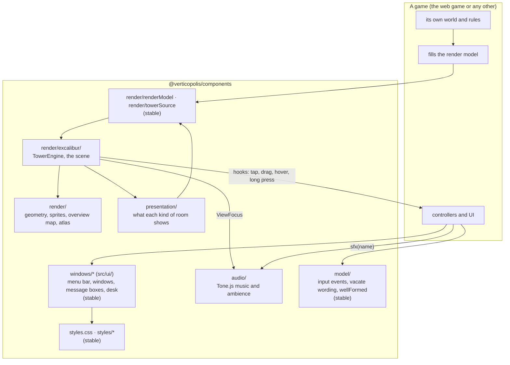
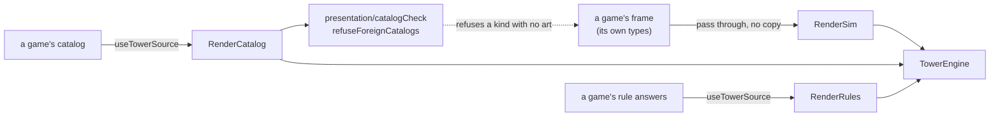
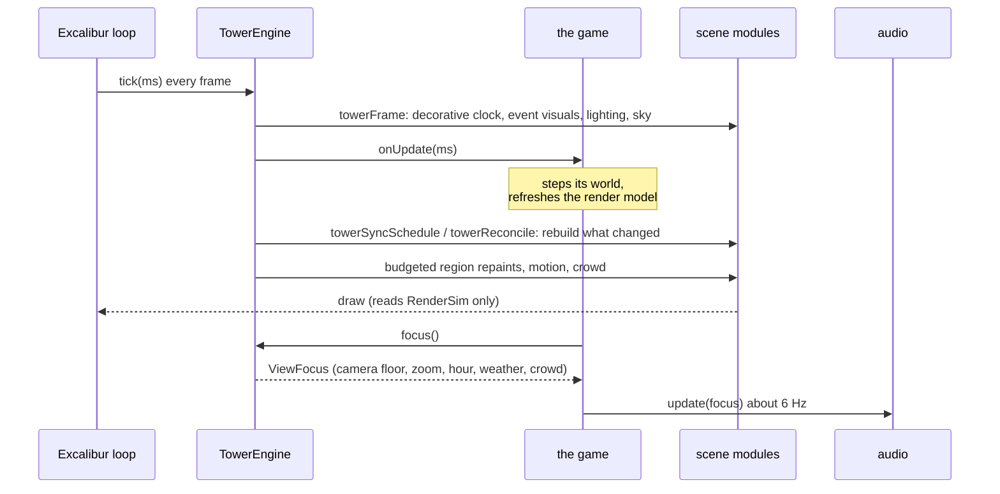
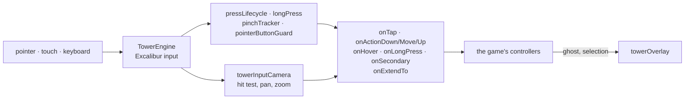
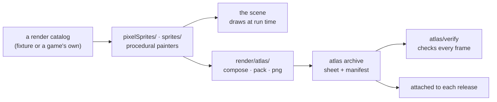
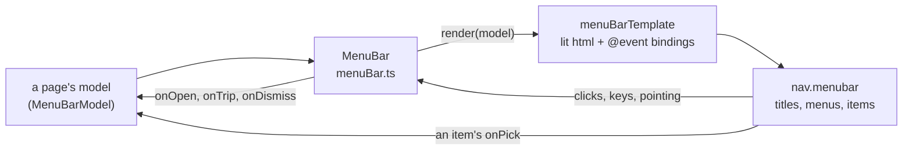
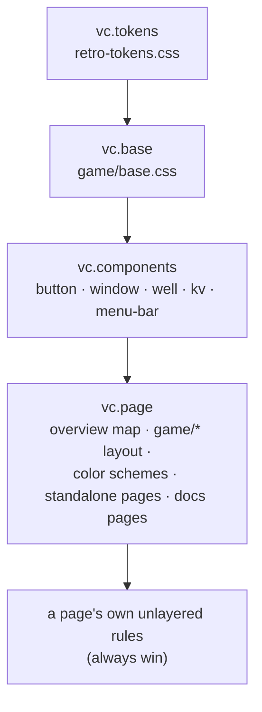
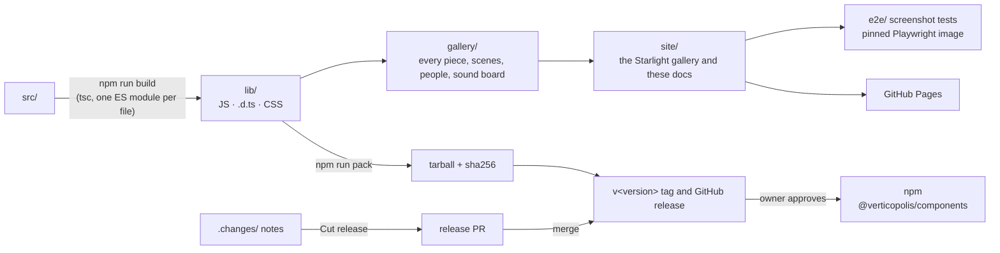

# Architecture

How the components are put together: the render model a game fills, the
Excalibur scene that draws it, how a frame and a press flow, the procedural
sprites and the atlas, the Win95 windows and their stylesheet, the audio
layer, and how the package is built and released.

The diagrams are [Mermaid](https://mermaid.js.org/); GitHub renders them
inline. The [README](README.md) lists every subpath and its semver promise,
and the deeper pages are in [`docs/`](docs/): the [sprite atlas](docs/atlas.md),
the [design system](docs/design-system.md), [the desk](docs/desk.md) and the
[audio layer](docs/audio.md).

## The package at a glance

The components know nothing about the simulation. A game owns its world and
its rules, fills the render model from them, and hands the scene its input
hooks. Everything here reads that model, draws it, plays it and frames it in
Win95 chrome.

Excalibur, Tone.js and lit-html are peer dependencies. Only the sprite atlas
bake uses the one direct dependency, fflate.

## The render model: the only way in

`render/renderModel` declares everything the renderer reads, as plain
interfaces:

- `RenderSim`: one frame of the world (the clock, the tower, the crowd, the
  effects, the view).
- `RenderCatalog`: the catalog fields the renderer draws from (sizes, kinds,
  subtypes), with `FacilityKind` the kinds this build has art for.
- `RenderRules`: whether a room is present and operating, and the zoom
  limits.

A game whose objects already have those fields passes them through with no
copy, and its own typecheck fails when one of them drops or retypes a field
the renderer reads. Each tower gets its catalog and rules once, through
`useTowerSource(tower, { catalog, rules })` in `render/towerSource`.

The unit tests, the gallery and the atlas bake fill the model from
hand-written fixtures (`src/tests/catalogFixture.ts`, one per mode, and
`src/tests/renderRules.ts`), so nothing here needs a running world.

## One frame

Excalibur drives the loop. Each frame `TowerEngine`
(`src/render/excalibur/TowerEngine.ts`) first runs its own per-frame work
(`towerFrame.ts`: the decorative clock, the event visuals, the lighting and
the sky), then calls the game's `onUpdate(ms)`, where the game steps its world
and refreshes the render model, then brings the scene in line with the model.
Drawing never writes back to the model. A frame that throws is handed to
`onFrameError`, so one bad frame skips instead of stopping Excalibur's loop.

The scene splits by layer, one module each: the structure and its tiles
(`towerStructTiles.ts`, `towerReconcile.ts`), the crowd (`towerCrowd*.ts`,
`crowdCull.ts`), the elevator cabs (`cab*.ts`), the scenery and sky
(`towerScenery*.ts`, `sceneBake.ts`), the event effects (fire response, the
thief, the metro) and the overlay that draws the placement ghost and its
label (`towerOverlay.ts`, `towerGhostLabel.ts`).

## Input: a press becomes a hook

The scene owns the camera and pointer input. It hit-tests the world
(`towerInputCamera.ts`), classifies the gesture (tap, drag, long press,
pinch, a secondary press) and calls the game back through a hook with the
tile, the floor and what was picked. The game decides what the press means.

## Sprites and the atlas

Every sprite is procedural: `render/pixelSprites/` and `render/sprites/`
paint rooms, people, cars and scenery in code, and the scene draws them
directly. The atlas bake (`render/atlas/`) paints the same sprites into one
sheet with a manifest, for a frontend that would rather load images; each
release carries the baked atlas. [docs/atlas.md](docs/atlas.md) covers the
archive, the manifest, depth layers and how it is checked.

## Windows and styles

The Win95 chrome is DOM: the menu bar
(`src/ui/menuBar.ts`), modal message boxes (`ModalShell` in `uiModal.ts`), movable windows
(`movableWindow.ts`), the 1994 desk's windows, taskbar and touchscreen modes
(`src/ui/desk/`, `deskPocket.ts` for phones and tablets), the overview
map's input and the icons. Each window module imports the stylesheet it needs.
`styles.css` is the whole look in one import; every sheet sits in a cascade
layer under `vc`, so a page's own unlayered rule always wins and the pieces
keep their order. [docs/design-system.md](docs/design-system.md) is the
contract for the tokens, the components and the window grammar.

The DOM is drawn with lit-html templates, and an element's events are bound
in its template (`@click`, `@keydown`). A page hands a component a model and
writes no markup of its own. The menu bar draws itself from a `MenuBarModel`
(`menuBarTemplate.ts`); a page re-renders it with a changed model (fresh
check marks as a menu opens), and lit touches only what changed. Listeners
stay imperative only where no template owns the element: the window and the
document (the menu bar's outside press and Alt keys), and a window the game
draws that a module moves (`movableWindow.ts`).

## Audio

The audio layer synthesizes the game's music and ambience live on Tone.js.
A small facade loads at boot; the heavy audio engine loads on the first
gesture. The game fires cues and hands over the camera's focus; the layer
never decides a rule. [docs/audio.md](docs/audio.md) has the module map, the
bus graph, the lifecycle and the ambient layer.

## Build, gallery and release

Only CSS counts as a side effect, so a bundler drops every module a game does
not import. The README covers the gates, the gallery, the screenshot
baselines and releasing in full.

## Where to go next

- [README.md](README.md): the subpaths and their promises, styles, build and
  test, the gallery, screenshot tests and releasing.
- [docs/design-system.md](docs/design-system.md): tokens, components and the
  window grammar.
- [docs/desk.md](docs/desk.md): the 1994 desk's windows, window menu, layout
  and stylesheet.
- [docs/audio.md](docs/audio.md): the audio layer.
- [docs/atlas.md](docs/atlas.md): the sprite atlas.
- [CHANGELOG.md](CHANGELOG.md) and [`.changes/`](.changes/README.md).
