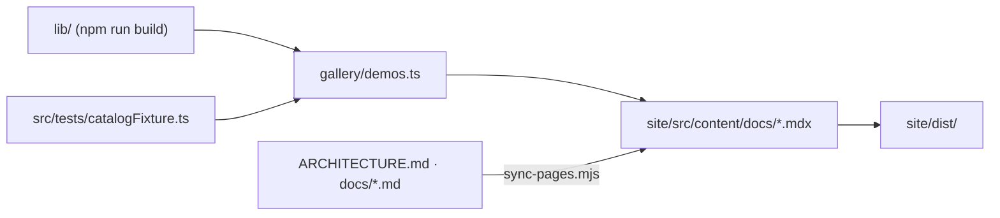

# Verticopolis components

The TypeScript pieces of [Verticopolis](https://verticopolis.com) that a
frontend builds on: the renderer and Excalibur scene, the Win95 windows and
menus, and the procedural sprites and audio. The web game is built from them,
and so can any other game. The components know nothing about the
simulation: they draw a render model (`render/renderModel`) that the game
fills.

[ARCHITECTURE.md](ARCHITECTURE.md) is a tour of the package in diagrams: the
render model, a frame, input, the sprites and atlas, the windows and styles,
audio, and the build and release. The deeper pages are in `docs/`: the
[sprite atlas](docs/atlas.md), the [design system](docs/design-system.md),
[the desk](docs/desk.md) and the [audio layer](docs/audio.md).

## The Verticopolis repositories

| Repository | What it holds |
| --- | --- |
| [Verticopolis/engine](https://github.com/Verticopolis/engine) | The Rust simulation engine, its WebAssembly package and the conformance lock |
| **[Verticopolis/components](https://github.com/Verticopolis/components)** (this one) | The renderer, windows and menus, and audio |
| [Verticopolis/web](https://github.com/Verticopolis/web) | The web game at [verticopolis.com](https://verticopolis.com) and its player's manual |

The web game depends on both and joins them: it runs the engine and hands
what the engine reports to the renderer as the render model. The components
do not depend on the engine.

## Use it

```sh
npm install @verticopolis/components excalibur tone lit-html
```

Excalibur, Tone.js and lit-html are peer dependencies, so the game installs
its own copy of each beside the components.

The one direct dependency is fflate, which the sprite atlas bake
(`render/atlas/archive`, `render/atlas/png`) uses to write PNG and zip files.
No module a game draws with imports it, so a game that uses fflate itself
(the web game reads and writes saves with it) installs one copy for both.

Each release on GitHub (tagged `v<version>`, or `components-v<version>` up
to 0.2.1) carries the same tarball npm serves, with its SHA-256 checksum,
so a download can be checked against the release. Versions published from
the release workflow also carry npm provenance.

The package ships compiled JavaScript (ES modules, one file per source
module, with `.d.ts` types and source maps). The types are written for a
bundler (`"moduleResolution": "bundler"` in a game's tsconfig). Only the CSS files count as side
effects, so a bundler drops every module a game does not import.

Each folder is a subpath export, and each subpath is either **stable** or
**internal**:

- **Stable** subpaths follow semver. A breaking change to one (a removed or
  renamed export, a narrower type, a selector a page styles against) waits
  for the next major version, so a game can depend on a range
  (`"@verticopolis/components": "^1.0.0"`).
- **Internal** subpaths are the parts the stable ones are built from. A game
  may import them, but they can change in any minor version, so a game that
  does pins an exact version. Members marked `@internal` in a stable module
  are internal too.

| Import | Folder | What it is | Promise |
| --- | --- | --- | --- |
| `@verticopolis/components/windows/*` | `src/ui/` | The Win95 windows, menus and message boxes | Stable |
| `@verticopolis/components/styles.css` | `src/styles.css` | The styles the windows use | Stable |
| `@verticopolis/components/styles/*` | `src/styles/` | The stylesheets `styles.css` imports, one by one | Stable |
| `@verticopolis/components/model/*` | `src/model/` | Input events, the vacate reasons' wording and `wellFormed` (a string with a lone surrogate repaired) | Stable |
| `@verticopolis/components/render/renderModel` | `src/render/renderModel.ts` | What the renderer reads (below) | Stable |
| `@verticopolis/components/render/towerSource` | `src/render/towerSource.ts` | How a game gives each tower its catalog and rules | Stable |
| `@verticopolis/components/render/excalibur/*` | `src/render/excalibur/` | The Excalibur scene a game mounts (`TowerEngine`) and the modules it is built from | Internal |
| `@verticopolis/components/render/*` (the rest) | `src/render/` | The tower renderer's geometry, the procedural sprites, the overview map and the atlas bake | Internal |
| `@verticopolis/components/presentation/*` | `src/presentation/` | What the view shows for each kind of room | Internal |
| `@verticopolis/components/audio/*` | `src/audio/` | The procedural music and ambience on Tone.js | Internal |

One stable module names types from an internal one, and those types share
the stable promise: `MapCamera`, `MapCameraCenter`, `MapExtent`, `MapLayout`
and `MapRect` from `render/overviewMap/geometry`, which
`windows/overviewMapInput` takes and returns. No other stable declaration
imports an internal module. The Map window's other modules
(`windows/overviewMapWindow`, `windows/overviewMapViews` and the modules they
are built from) name the overview map's internal types throughout, so they
are internal for now, and a game that mounts the Map pins an exact version.

The scene is internal for now: `TowerEngine`'s public members mix what a game
calls with what the scene's own modules share, and its declarations name
internal types (`render/scale`'s `FLOOR` and `TILE`, `PinchTracker`,
`FlightPass` and others), so a game that mounts it pins an exact version.

For example, `import { MenuBar } from "@verticopolis/components/windows/menuBar"`.
A component draws itself from a model with lit-html, so a page writes no
markup for it:

```ts
import { MenuBar } from "@verticopolis/components/windows/menuBar";

const bar = new MenuBar(host, {
  label: "Game menu",
  menus: [{ id: "mb-file", label: "File", mnemonic: 0, items: [{ label: "New…", onPick: newTower }] }],
});
```

### The render model

`render/renderModel` declares everything the renderer reads: `RenderSim` (the
clock, the tower, the crowd and the effects of one frame), `RenderCatalog`
(the catalog fields it draws from) and `RenderRules` (whether a room is
present and operating, and the zoom limits). A game fills them from its own
simulation; the types are plain interfaces, so a game whose objects already
have those fields passes them through with no copy, and its typecheck fails
when one of them drops or retypes a field the renderer reads.

Each tower's catalog and rules are set with
`useTowerSource(tower, { catalog, rules })` from `render/towerSource`.
`presentation/catalogCheck`'s `refuseForeignCatalogs` lets a game refuse a
catalog with a kind this build has no art for, and `presentation/clockOf`
words the header's date and the clock for the panels.

### Styles

The whole game look is one import, which pulls in the tokens, the shared
components, every piece, the game layers and both color schemes, in cascade
order:

```js
import "@verticopolis/components/styles.css";
```

A page that wants only some pieces imports them from one stylesheet of its
own. Each piece imports what it needs (the tokens, and a window's title-bar
button), so naming a piece is enough, and inside one stylesheet a bundler
inlines each file once, in the order of its first `@import`:

```css
/* page.css: import this file once, from JS or a <link> */
@import "@verticopolis/components/styles/button.css";       /* .btn and its looks */
@import "@verticopolis/components/styles/window.css";       /* .win, .win-title (with the button) */
@import "@verticopolis/components/styles/well.css";         /* .well, .field */
@import "@verticopolis/components/styles/kv.css";           /* .kv */
@import "@verticopolis/components/styles/menu-bar.css";     /* the Win95 menu bar */
@import "@verticopolis/components/styles/overview-map.css"; /* the overview map (with the window) */
@import "@verticopolis/components/styles/overview-map-views.css"; /* its View row (with the map) */
```

The window modules bring their own stylesheet. `windows/menuBar` imports
`menu-bar.css`, and `windows/uiModal` and `windows/movableWindow` (so
`windows/desk/deskWindow` too) import `window.css`, so a page that uses only
those modules needs no stylesheet import for them. That needs a bundler that
loads CSS imported from JavaScript, as Vite does: plain Node has no loader
for `.css` and cannot import those modules, while a test runner built on a
bundler (Vitest) can. Their declarations do not carry the CSS imports.

When a module and a page's stylesheet bring the same sheet, the bundle may
hold two copies of it. That changes nothing on screen: each piece sits in a
cascade layer of its own and the tokens in theirs (see "Cascade layers"), so
a copy cannot move one piece ahead of another, and a page's own rules, a
token override on `:root` included, beat every copy. Importing the other
pieces from one CSS file rather than one JS `import` each still keeps the
bundle to one copy of each.

- `styles/retro-tokens.css` holds the colors, bevels and fonts every piece is
  skinned from. Every piece imports it, so a page imports it on its own only
  to read the custom properties.
- `styles/retro-components.css` is the button, window, well and key/value grid
  together, in that order.
- `styles/retro-page.css` is for a standalone page (the sprite gallery, the
  404 page): it imports the tokens and components itself and adds a full-page
  layout and a dark-ground override. `styles.css` does not include it.
- `styles/not-found.css` is the "page not found" page. It imports
  `retro-page.css` itself, so it is the only file that page needs.
- `styles/starlight.css` dresses a [Starlight](https://starlight.astro.build)
  docs site in the game's look: the tokens, `styles/starlight-theme.css` (the
  How to Play window's title bar, sidebar and well, and the title screen for a
  page with a hero), `styles/title-bar.css` and `styles/starlight-schemes.css`,
  in that order (a `customCss` entry). Starlight puts its own CSS in the `starlight` layer, so the site
  declares `@layer starlight, vc;` in a `<style>` through Starlight's `head`
  option: `head: [{ tag: "style", content: "@layer starlight, vc;" }]`. A
  `customCss` entry comes too late for that, since Astro puts the CSS a
  page's scripts import (the menu bar's, from `windows/menuBar`) ahead of
  `customCss`, and that CSS would set `vc` first.
  The title screen's skyline is `styles/splash-skyline.svg`, which the build
  writes beside the stylesheet, so a site serves nothing of its own for it.
- `astro/TitleBar.astro` and `astro/TitleScreen.astro` are the docs title bar
  and the title screen as [Astro](https://astro.build) components, for a
  Starlight site's `Header` and `Hero` overrides. Each takes everything it
  shows as props (the site's name, logo, links and buttons) and reads nothing
  from Starlight; the title bar takes Starlight's `Search` and `ThemeSelect`
  in its `search` and `theme` slots. The package lists the `astro-component`
  keyword, so Astro compiles them from `node_modules`. The gallery's
  [Docs sites](https://components.verticopolis.com/docs-sites/) page shows
  both:

  ```astro
  ---
  import TitleBar from "@verticopolis/components/astro/TitleBar.astro";
  import Search from "@astrojs/starlight/components/Search.astro";
  import ThemeSelect from "@astrojs/starlight/components/ThemeSelect.astro";
  import logo from "../assets/logo.png";
  const { siteTitle, siteTitleHref } = Astro.locals.starlightRoute;
  ---
  <TitleBar logo={logo} title={siteTitle} short="Help" href={siteTitleHref} github="https://github.com/Verticopolis/web">
    <Search slot="search" />
    <ThemeSelect slot="theme" />
  </TitleBar>
  ```
- `styles/starlight-schemes.css` gives a Starlight docs site's chrome the
  game's color schemes (the header, the selected row, the buttons and, in
  High Contrast, Starlight's own colors). Like the game's scheme files, each
  rule applies only under `html[data-scheme="skyline"]` or
  `html[data-scheme="high_contrast"]`, which the site sets from the scheme
  the player picked. `styles/starlight.css` includes it.
- `styles/starlight-menu-bar.css` puts the game's menu bar (`menu-bar.css`,
  which it imports) across the top of a Starlight site, above the title bar:
  the header grows by the bar's height. A site with the bar adds it as a
  second `customCss` entry after `starlight.css`, gives its Header override a
  host element with the `starlight-menubar` class first, and draws the bar
  into it with `windows/siteMenu`. A site without the bar leaves it out.
- `windows/siteMenu` is that bar. Every docs site wears the same one: File
  (the site's own items, then Print), Edit (Find, Copy Link to This Page),
  Options (Light, Dark or Match My Device, and the appearance schemes when the
  site offers them) and Help (the site's own items). `mountSiteMenu(root,
  deps, items)` draws it; `starlightDeps()` wires Print, Find, Copy Link and
  the look to a Starlight page, and `schemeDeps(key)` adds the schemes, kept
  under `key`. A `picked(code)` dep hears each built-in item's code (`print`,
  `find`, `copy_link`, `theme_light`, `theme_dark`, `theme_auto`,
  `scheme_<id>`), so a site can count picks:

  ```ts
  import { mountSiteMenu, schemeDeps, starlightDeps } from "@verticopolis/components/windows/siteMenu";

  mountSiteMenu(host, { ...starlightDeps(), ...schemeDeps("my-site-scheme") }, {
    file: [{ label: "Play Verticopolis", href: "https://verticopolis.com/" }],
    help: [{ label: "Player's Manual", href: "https://help.verticopolis.com/" }],
  });
  ```
- `styles/title-bar.css` is the docs title bar on its own: the `.vc-bar`
  markup a docs site draws in its header, and that a page outside Starlight
  (such as `cargo doc` output) can draw on a navy bar of its own. Such a page
  takes the rules out of their `vc.page` layer (and drops the `@import`)
  when it inlines the file: rustdoc's own stylesheets are unlayered, so they
  beat a layered rule, and the bar's links come out navy on navy.
- `styles/schemes/skyline.css` and `styles/schemes/high-contrast.css` are the
  optional color schemes. Each applies only under `html[data-scheme="skyline"]`
  or `html[data-scheme="high_contrast"]`, and goes last. `windows/schemes`
  lists the schemes with their names and sets or reads the attribute
  (`applyScheme`, `schemeOf`, and `loadScheme` and `saveScheme` under a key
  the page names). It imports no stylesheet and no lit, so a site's config
  can import it in Node. `windows/appearance` is the Appearance dialog that
  picks one (`openAppearanceDialog`, or `appearanceView` for a `ModalShell`
  the caller drives); it imports `styles/game/appearance.css`.
- `windows/fileDialog/fileDialog` is the Open and Save As windows
  (`showFileDialog(shell, ctx)` in a `ModalShell`), and
  `windows/fileDialog/versionsDialog` is Previous Versions. They hold no
  storage: the caller lists the files, runs each command and names its files
  (`words`, `kinds` with their icon marks from `windows/fileDialog/fileIcons`,
  the kind Save As writes, and the name rules). Both import
  `styles/game/file-dialog.css`.
- `windows/titleScreen/titleScreen` is the game's title screen: the dusk
  sky, sun and skyline (`titleSceneTemplate`), the wordmark
  (`wordmarkTemplate`), and `titleScreenTemplate(view)` with the buttons, the
  small print and the optional mute, install and sponsor corners the caller
  hands in. A page renders it into its own `#splash` container. It imports
  `styles/game/splash.css`.
- `windows/alertCard` is the alert card (`new AlertCard(doc, id, view)`): a
  modal dialog that holds the page until one of its buttons is pressed, such
  as a crash card, or a wait card with no buttons that its caller closes.
  `windows/updateBox` is the update box (`updateBoxView(view, actions)` for a
  `ModalShell`): what is new, the build lines, Later and Update now. The
  caller writes every word. Their look is `styles/game/dialogs.css`, part of
  `styles.css`.
- `styles/game/*` is the game page's own layout. It targets the game's markup
  and depends on the order `styles.css` gives it, so import `styles.css`
  rather than these files one by one.

#### Cascade layers

Every rule the components ship sits in a cascade layer under `vc`, declared
in this order at the top of every stylesheet:

```css
@layer vc.tokens, vc.base, vc.components, vc.page;
```

- `vc.tokens`: `retro-tokens.css`, the custom properties.
- `vc.base`: `game/base.css`, the reset and the document.
- `vc.components`: the button, window, well, key/value grid and menu bar,
  each in a layer of its own in that order (`vc.components.button` through
  `vc.components.menu-bar`, declared in a second statement), so a second copy
  of a sheet cannot change their order.
- `vc.page`: the overview map (`overview-map.css`, `overview-map-views.css`,
  which lay out the game's stage around the map), the game's layout
  (`styles/game/*`), the color schemes and the standalone pages
  (`retro-page.css`, `not-found.css`), in the order `styles.css` imports them,
  and the docs pages (`starlight-theme.css`, `title-bar.css`,
  `starlight-schemes.css`, then `starlight-menu-bar.css`).

A later layer beats an earlier one whatever the selectors, and a rule a page
writes outside any layer beats every `vc` rule, wherever the bundler puts the
two stylesheets. So a page restyles a piece with an ordinary rule, and a
token override on `:root` always wins. Two things work the other way round:
a `!important` inside a `vc` layer beats an unlayered `!important`, and a page
that puts its own CSS in layers orders them against `vc` with a statement of
its own before it loads the components (for example `@layer vc, app;`, or
`@layer starlight, vc;` on a Starlight site so the menu bar keeps its look).
That statement has to come before the first components CSS on the page,
including the sheet a window module imports, which a bundler may put ahead of
the page's own stylesheets.

Every stylesheet counts as a side effect, so a bundler keeps a CSS import even
though nothing names what it exports.

## Build and test

```sh
npm ci
npm run typecheck        # the library, then its tests, scripts/ and e2e/ (gallery/ reads lib/, so the Gallery workflow checks it after building)
npm run lint             # ESLint on src/, scripts/, gallery/ and e2e/, with eslint-plugin-lit on the templates
npm run icons:check      # the pixelarticons paths match the package; `npm run icons` rewrites them
npm run format:check     # Prettier; `npm run format` rewrites the files
npm test
npm run build                 # compiles src/ into lib/, what the package ships
npm run pack -- 0.0.0-local   # writes dist/verticopolis-components-0.0.0-local.tgz
```

The unit tests and the sprite atlas bake draw from hand-written render
catalogs (`src/tests/catalogFixture.ts`, one per mode) and render rules
(`src/tests/renderRules.ts`), so they need no simulation. A game bakes the
atlas from its own Modern catalog with
`npm run atlas -- --catalog <file>` ([docs/atlas.md](docs/atlas.md)). Every pull request and
push to `main` packs the tarball as a workflow artifact.

## Gallery

The component gallery is an Astro and Starlight site in `site/`, built on the
same shell as the player's manual and the engine docs: the package's
Starlight stylesheet, a title bar, and a working menu bar across the top.
Its File menu opens the game, the package on npm and the source, and prints
the page; Edit finds and copies a link; Options picks light, dark or the
device's look and a color scheme (Standard, Skyline, High Contrast); Help
links to the manual, the engine docs and the issue form.

Each page mounts demos from `gallery/` (`gallery/demos.ts`), which load the
built package from `lib/` the way a consumer would:

| Page | What it shows |
| --- | --- |
| Buttons, Windows, Wells | the chrome, in the scheme Options picks |
| Menu bar | a sample menu bar, the same component the site's own bar uses |
| Message boxes | `windows/messageBox` in the modal: a message, a question, a warning with its icon, and a notice |
| Alert cards and updates | `windows/alertCard`: a crash card with a status line and a wait card; `windows/updateBox` in the modal, after one version and after several |
| Appearance | the Appearance dialog; OK dresses the site in the picked scheme |
| Open and Save As | the Open, Save As and Previous Versions windows over a made-up folder that lives only on the page |
| Title screen | the game's title screen in a frame, with sample buttons and every corner |
| Map window | the tower map in a stage of its own over a made-up tower, with its views, legends, keys and taps |
| The desk | the 1994 desk live: desk windows that move, minimize, maximize and resize, the window menu, and the taskbar with its Verticopolis menu and tray |
| Where windows open | `defaultLayout` drawn to scale on three screen sizes |
| Icons | every icon |
| Sounds | each action effect, both music tracks and the ambience of each part of a tower |
| Lobbies, Stairs and escalators, Elevators | hand-written slices of a tower: ground and sky lobbies one to three stories tall, halls of two heights, stairs, escalators and elevators |
| Rooms | every room and variant at an hour it is open, with a share of its capacity inside so its furniture shows |
| People | every look a figure wears (the visitors, the housekeeping crew, the staff and the thief), each walk frame, pose and mood, and the room builds |
| Docs | [ARCHITECTURE.md](ARCHITECTURE.md) and the pages in `docs/`, copied from the repository at build time |



Each room, scene and section of the People page links to where the player's
manual (help.verticopolis.com) covers it; the pages and anchors live in
`gallery/manual.ts`.

The Docs pages have one source, the Markdown files in this repository:
`site/scripts/sync-pages.mjs` copies the pages listed in `site/pages.json`
into the site before each build, points their links at the site or at
GitHub, and turns each mermaid block into a diagram drawn in the browser.

The scenes, rooms and people are painted from the components' own render
catalog (`src/tests/catalogFixture.ts`). The overview map is not on it, since
it draws a running tower.

```sh
npm run build           # first: the gallery and its config (site.mjs) read lib/
npm run gallery:install # the site's own packages (site/package-lock.json)
npm run gallery         # a local server with the site
npm run gallery:build   # writes site/dist/
```

The Gallery workflow builds it on every pull request that touches the source,
the demos or the site, and publishes it to GitHub Pages from `main`
(components.verticopolis.com). Each open pull request that changes the
gallery gets a preview at `pr-preview/pr-<number>/` under the same site,
linked in a comment on the pull request; the preview goes away with the next
deploy after the pull request closes. `GALLERY_BASE` sets the folder a build
is served from.

## Screenshot tests

The Screenshots workflow drives the gallery site in Chromium and compares
each piece with the images in `e2e/__screenshots__`: the site's header and
each menu of its menu bar open, the buttons, windows, wells, icons, the sound
board, the sample menu bar closed and with each menu open, each message box,
and the desk with its Verticopolis menu, its window menu and a maximized and
a minimized window in every color scheme, plus the desk layouts, each tower
scene, room sprite and people figure once, on a
desktop and a phone screen. A change that moves a pixel fails the check, and
the run keeps the diffs as an artifact.

The baselines come only from the pinned Playwright image
(`mcr.microsoft.com/playwright:v<version>-jammy`, the version in
`package-lock.json`), since glyph and canvas rasterization differ across
Chromium builds. To refresh them, push a commit whose message contains
`[update-screenshots]`; the Update screenshots workflow renders them in that
image and pushes them back as a commit on the branch. Run from the Actions
tab on `main`, it opens a pull request with the images instead of pushing to
`main`. Review that commit's images like code. The same image works locally:

```sh
npm ci && npm run gallery:install
docker run --rm --ipc=host -v "$PWD":/work -w /work \
  mcr.microsoft.com/playwright:v<version>-jammy \
  sh -c 'CI=1 npx playwright test --update-snapshots'
```

`npm run screenshots` on any other browser runs the specs but skips the
pixel comparison (`PW_VISUAL=1` compares anyway).

## Releasing

A pull request that changes what the package ships adds a change note under
[`.changes/`](.changes/README.md), named after its branch, with its level
and its [`CHANGELOG.md`](CHANGELOG.md) entries: **major** for a breaking
change to a stable subpath's exports or a stylesheet's selectors, **minor**
for a new export, component or look, or any change to an internal subpath,
**patch** for a fix, and `none` for a change that ships nothing new. Notes keep two open pull requests from editing the
same changelog lines. The **Change notes** check requires one when a pull
request changes what the package ships (the paths are in
[`.changes/README.md`](.changes/README.md)), and refuses a feature pull
request that changes the version or the changelog's version sections.

**Cut release** (`.github/workflows/cut-release.yml`) opens the release PR,
as in the game's repository: run it from the Actions tab on `main`. It runs
`scripts/cut-release.ts`, which takes the highest level among the change
notes, raises `version` in `package.json` and `package-lock.json` with
`npm version`, writes the notes' entries into a new `## <version> (<date>)`
section of `CHANGELOG.md` (each led by its level, the highest first),
deletes the notes, commits that to `release/<version>` and
opens the "Release components <version>" PR. While the package is 0.x, a
**major** note raises the minor version; 1.0.0 comes only when the version
is named in the run. Leave the version empty for the level the notes ask
for, or name a later one. It refuses while another release PR is open. The
PR comes from the workflow token, which starts no checks, so start them with
the run button on the PR, or close and reopen it. The workflow needs "Allow
GitHub Actions to create and approve pull requests" (Settings, Actions,
General). To cut one by hand instead, run `node scripts/cut-release.ts` on a
clean `release/<version>` branch off `main`.

When the release PR merges, **Release components**
(`.github/workflows/components-release.yml`) packs that commit, tags
`v<version>` on it, publishes the GitHub release (named after the tag, and
Latest unless it is a prerelease) with the version's changelog section, the
tarball and its checksum, and then publishes that same tarball to npm and
bakes the sprite atlas onto the release ([docs/atlas.md](docs/atlas.md)). It
refuses a version with no changelog section, before it tags anything. Only the npm publish waits on the
`registry` environment, which only the owner approves, so a release takes
one approval. npm publishing uses
trusted publishing, so no npm token is stored anywhere and each version
carries an npm provenance statement.

A push that leaves the version alone releases nothing. A tag, release or npm
version that already exists is left alone, so running the workflow again
from the Actions tab on `main` finishes what a failed run started.

## Contributing

The components came out of the game's repository, and its rules came with
them: American English, no em-dashes in prose, a 500-line ceiling per source
file, and unit tests that assert what they name, with hand-written fakes.
Every piece of UI is drawn with lit-html templates and `@event` bindings;
markup strings and hand-built DOM are not allowed.
[CONTRIBUTING.md](CONTRIBUTING.md) has the rules in full.

Pull requests and issues for the components open here. The game takes a
change when a pull request in Verticopolis/web raises its
`@verticopolis/components` pin.

## History

This repository was extracted from `maniator/verticopolis`, now
Verticopolis/web, with every past path of every file kept, so `git log` and
`git blame` reach back to each line's first commit with the original authors,
dates and messages. `#123` in an old commit message was rewritten to
`Verticopolis/web#123`, the issue or pull request it meant.
`history/commit-map.txt` maps each commit here to the one it came from.

## License

Code is MIT, see [LICENSE](LICENSE). The visual and audio assets are CC BY 4.0,
see [ASSETS-LICENSE.md](ASSETS-LICENSE.md).
