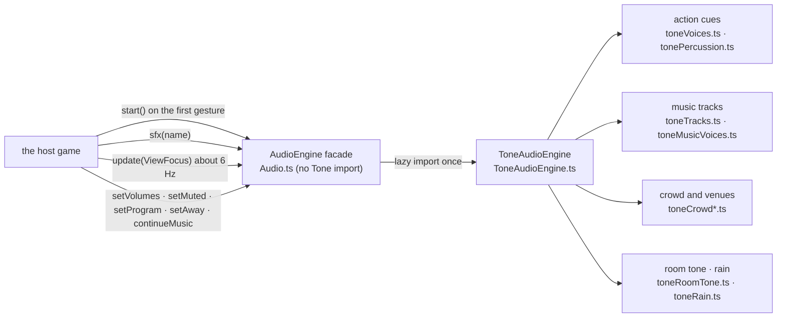
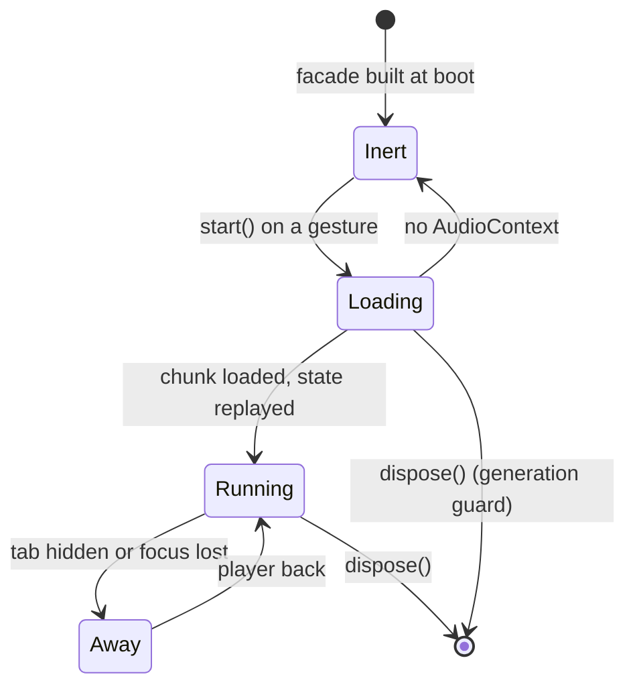

# Audio

> **Snapshot of the source on 2026-10-15, moved here 2026-11-20.** Every
> number here (gains, rates, frequencies, timings, budgets) is copied by hand
> from the source and does not refresh. The files named in each section hold
> the live values.

How the package makes noise: the modules in `src/audio/`
(`@verticopolis/components/audio/*`), the bus graph, the lifecycle, the cue
vocabulary and the ambient layer. Below, "the audio engine" means
`ToneAudioEngine` and "the facade" means `AudioEngine` in `Audio.ts`.

What fires a cue, what the player's settings are, and which sounds are
planned next belong to the game that hosts the audio: the web game's side is
[`SOUNDS.md`](https://github.com/Verticopolis/web/blob/main/SOUNDS.md) in
Verticopolis/web. Issue numbers (`#N`) on this page are Verticopolis/web's,
where it lived until 2026-11-20.

## The goal

The 1994 original's soundscape was dynamic in a specific way. It was a
building you could hear: sounds arrived at their own rates, layered without
coordinating, and changed with the hour and with where you were looking.

- **Probability.** An elevator arrival sometimes made a sound and sometimes
  stayed quiet. That is most of why it never became tiring; a cue that fires on
  every instance of a frequent event becomes noise within a minute.
- **Stacking.** Typing, registers, whirs, and the crowd ran at once at
  independent rates, and the density of the pile was the information.
- **Time of day.** Birds at sunrise, an owl at night. They tell you the hour
  while you are looking at something else, and give the tower a park-like
  quality a purely mechanical building would lack.

The crowd layer already has this machinery. When weighing a new
sound, ask whether it thickens that soundscape or merely announces an event.

## The short version

- Sound is **Tone.js**, synthesized live. Excalibur's audio system is not used
  at all: Excalibur draws the tower and nothing more. No `ex.Sound`, no audio
  `Loader`, no per-cue asset files.
- Almost nothing is sampled. The only recordings are `audio/voice-talk.mp3`
  and `audio/voice-laughs.mp3` (`audioAssets.ts`), gibberish talk and
  laughter the owner recorded, which the crowd layer chops into murmur. The
  host serves them under its base URL. Everything else is generated at run
  time.
- The music and action cues are transcriptions of the owner's own recordings
  (hums, chest hits, taps, a bloop, a ping). New cues should speak in that
  voice rather than introduce a fresh instrument.
- Every sound is original to Verticopolis, UI effects included: synthesized in
  code, rendered from the project's code, or recorded by the owner. No
  third-party sample or sound pack ships, free or paid.
- The audio layer only plays. The host tells it what to play (`sfx(name)`),
  where the camera is (`update(focus)`), the program and the player's levels.
  It never decides a game rule.



`ViewFocus` is what the scene reports about its camera
(`src/render/excalibur/towerInputCamera.ts`): the floor at the middle of the
view, the zoom, the dominant kind, night, the hour, the weather and how full
the rooms in view are. A host hands the latest one to `update` about six times
a second.

## Module map

| File | Job |
| ---- | --- |
| `Audio.ts` | The `AudioEngine` facade a host builds at boot. No `tone` import; holds mute, volume and program synchronously and lazy-loads the audio engine on the first gesture. |
| `ToneAudioEngine.ts` | The live orchestrator: bus graph, every voice, the music `Tone.Part`, the ambient bed driven by camera focus. |
| `toneScenes.ts` | Scene vocabulary and pure math (`SCENES`, `sceneFor`, `midiToFreq`), plus the `SfxName` union. No Tone.js import. |
| `toneTracks.ts` | Composed music: note data for the two tracks and the builders that time them. No Tone.js import. |
| `toneVoices.ts` | Action jingles: the `SfxVoices` instrument set and `playSfx`. |
| `tonePercussion.ts` | The chest-hit thump and object-tap membrane voices. |
| `lightSynth.ts`, `lightEnvelope.ts` | Light voices: stand-ins for Tone's synths that build each note from two native nodes and release them when it ends, with Tone's own envelope curves. |
| `firstCueLatch.ts` | Holds the cue fired by the gesture that unlocks audio, so the very first click is heard. |
| `toneRain.ts` | The outdoor rain bed, on a dry path. |
| `toneRoomTone.ts` | The per-scene room-tone bed (filtered pink noise). |
| `toneMusicVoices.ts` | The tracks' pitched voices: arpeggio, bass and melody. |
| `toneContext.ts` | The one playback context, and `ContextSleep`, which suspends it while the player is away. |
| `awayWatch.ts` | Reports the player leaving the page (hidden tab or lost focus) and coming back. |
| `toneCrowd.ts` | The crowd and venue ambience layer: talkers, per-scene details, venue programs. |
| `toneCrowdData.ts` | Crowd specs and math, including the `pseudo` hash the layer varies itself with. |
| `toneCrowdVoices.ts` | Slices the two seed mp3s into murmur grains. |
| `toneCrowdPrograms.ts` | `PartyBand`, `CinemaProgram`, `MetroProgram`. |
| `audioAssets.ts` | Every file the audio layer fetches at run time (`AUDIO_RUNTIME_FILES`) and the lazy chunk's name, so a host's offline precache check can find them. |

## The bus graph

- **`musicBus`** carries the composed tracks and percussion. The **Music**
  slider. Its output goes through the shared reverb.
- **`ambBus`** and **`ambDryBus`** carry the crowd layer, room tone, and rain.
  The **Ambience** slider. Two nodes because rain stays dry while the rest
  shares the reverb.
- **`sfxBus`** carries the action jingles. The **Effects** slider.
- **`master`** is downstream of all of them (directly, or through the shared
  reverb) at gain `0.35`; mute ramps it to zero.

A `bedFilter` lowpass on the ambient path opens as the camera zooms in, so
distance muffles the building's life. Music bypasses it.

The melodic voices reach `musicBus` through a short chain: a level gain, a
warm 2400 Hz lowpass, then a 90 Hz sub highpass. Percussion skips that chain
and connects to `musicBus` itself, so the tap stays bright and the thump keeps
its body; it still sits behind the Music slider, the shared reverb, and mute.

Three sliders plus mute is the whole player-facing surface. Levels live in
`Prefs`, are clamped in the facade before reaching an `AudioParam`, and are
read back from the facade so prefs never store junk.

## Lifecycle

Browsers refuse to make noise before a gesture, and the Tone.js chunk is
large (about 230 kB minified), so both are handled together. The host builds
the facade at boot with nothing heavy loaded. The first real gesture calls
`start()`, which feature-detects `AudioContext` (so tests and unsupported
environments never fetch the chunk), then dynamically imports
`ToneAudioEngine`. Once the audio engine exists the facade replays what it was
holding: mute, volumes, program, last focus, and the cue the unlocking
gesture fired (`firstCueLatch.ts`).



While the chunk loads, a second `start()` returns early. A `generation`
counter guards the load window, so a `dispose()` mid-flight cannot resurrect a
torn-down audio engine.

`setProgram("splash" | "game")` picks the track; the splash theme crossfades to
the in-game bed on entry.

A page can hand its track over to the next one. `musicTime` says how far into
its loop the music is, and `continueMusic(seconds, asOf)` on the next page's
facade (with `asOf` the `Date.now()` the position was read at) moves the
Transport to that point plus the time since, wrapped into the loop, as soon as
the player can hear it (`toneMusicPart.ts`). A launcher that hands over to a
game page this way keeps the same theme playing from the same beat; the new
page builds its graph silently while it is away, and the jump lands when it
comes on screen.

Leaving the page silences it. `awayWatch.ts` reports the player away while the
tab is hidden or the page has lost focus, and `setAway` fades the master out,
skips the music part's notes and any cues, quiets the crowd, and suspends the
context once the fade has played, so the music holds its place
(`ContextSleep` in `toneContext.ts`). Coming back resumes the context at the
player's own mute. This is kept apart from the player's mute. It fixed static
heard in a background tab: a backgrounded or unfocused page gets a throttled,
lower-priority main thread, so the notes it builds only 0.1 s ahead (Tone's
look-ahead) arrived late and crackled.

An installed game has to play every sound offline. `AUDIO_RUNTIME_FILES` and
the chunk name in `audioAssets.ts` are what a host's precache check reads;
`audioAssets.test.ts` fails when the source names an `audio/...` file the list
lacks, and `audioFetches.test.ts` fails when the audio engine loads one.

## The cue vocabulary

`SfxName` is the complete list of one-shot cues. All play through `sfxBus`.

| Cue | Sound |
| --- | ----- |
| `build` | One bloop swooping 520 Hz down to 180 Hz |
| `click` | A small, quick high bloop |
| `sell` | Two falling bloops |
| `error` | A slow, sighing double bloop |
| `promote` | The splash theme's peak turn on the ping bell |
| `notify` | A single ping on G4 |
| `money` | An ascending four-note arpeggio |

Where the web game fires each one is in its `SOUNDS.md`.

## The ambient layer

The cues are the small part. The soundscape lives in `toneCrowd.ts` with its
data in `toneCrowdData.ts`, and it is closer to the original's behavior than
the cue table suggests: the stacking, rate-driven, occupancy-scaled machinery
is **already built**. What is missing is mostly content and time-of-day gating.

A **scene** resolves from camera focus and the dominant facility kind: `lobby`,
`office`, `condo`, `hotel`, `restaurant`, `fastFood`, `shop`, `cinema`,
`partyHall`, `metro`, `outside`. Overview, quiet, and service areas resolve to
nothing and get music and room tone only. Each scene carries a **murmur spec**,
a list of **elements** (one-shot details on independent timers), a **gate**,
optionally a composed **program**, and optionally a **`crowdFloor`** for the
city's own spaces, which never fall fully silent (indoor rooms have none, so
empty means silent).

Everything is scheduled on timers seeded by the `pseudo` hash, so the layer
varies without `Math.random` and without a fixed loop becoming audible.
`outside` also swells a low street hum (two oscillators under an LFO) while it
is live.

### How firing works

There is no per-event probability roll. Each element runs a loop that sleeps a
drawn gap and fires:

```
gap = (rateMin + draw × rateVar) / clamp(activity, 0.2, 1)
activity = hourActivity(gate, hour) × crowdFactor
```

- **`rateMin`/`rateVar` describe a gap.** Bigger means rarer.
- **Low activity stretches the gap, up to 5x.** The clamp floors at 0.2, so a
  near-empty office types at a fifth of its busy rate instead of falling
  silent. This is what produces "quiet but alive."
- **Zero activity idles the loop.** When the gate reads 0 (an office at
  3 a.m.) or the crowd is below 5% (`EMPTY_CROWD`), activity is exactly zero:
  the loop fires nothing and only re-checks every couple of seconds. The 0.2
  floor applies only while activity is above zero. `metro` and `outside` set
  a `crowdFloor`, so their crowd never drops below 5%.

So a sound's "probability" is really its average firings per minute, which is
what the tables give, quoted **at full activity**. Multiply by `activity` for
any other moment, down to the 0.2 floor. Camera position picks the scene.
Zooming out past the overview threshold (`OVERVIEW_ZOOM` 0.55, left again at
0.63) switches to the overview scene, which has no crowd layer, so nothing
fires. Within a scene, zoom only scales the layer's level and opens
`bedFilter`.

### Element sounds

`ping` and `thud` are pitched tones; `burst` is a noise hit whose frequency
column is a filter cutoff. Attack defaults to 0.004 s (a tick); longer is a
swish. "Companion" is the `pair` field: a second hit at that ratio, delay, and
relative gain. The per-minute figures count firings: every hit of a cluster
counts (a cluster of N hits has N - 1 short gaps, then the pause), and a
companion note does not, so the bird's ~11 firings a minute are ~22 chirps.

| Scene | Kind | Freq (Hz) | Dur (s) | Gain | Attack | Firing at full activity | Companion | Gate | What it is |
| --- | --- | --- | --- | --- | --- | --- | --- | --- | --- |
| office | burst | 750–900 | 0.012 | 0.02–0.04 | 0.004 | 4–12 hits @ ~0.13 s, then ~2.7 s pause (**~133/min**) | | workday | Typist one |
| office | burst | 750–900 | 0.012 | 0.02–0.04 | 0.004 | 4–12 hits @ ~0.14 s, then ~3.5 s pause (**~108/min**) | | workday | Typist two |
| office | burst | 650–750 | 0.35 | 0.03–0.05 | 0.08 | ~6.0 s gap (**~10/min**) | | workday | Page turn |
| condo | ping | 1150–1350 | 0.18 | 0.05–0.08 | 0.004 | ~8.0 s gap (**~7.5/min**) | | condoDay | Dish clink |
| condo | thud | 90–100 | 0.3 | 0.10–0.16 | 0.004 | ~12.0 s gap (**~5/min**) | | condoDay | Cupboard thud |
| hotel | thud | 64–76 | 0.12 | 0.05–0.09 | 0.004 | 5–9 hits @ ~0.47 s, then ~14 s pause (**~25/min**) | | always | Cart wheel bumps |
| hotel | thud | 105–115 | 0.35 | 0.14–0.20 | 0.004 | ~13.5 s gap (**~4.4/min**) | ×0.636, +0.02 s, 0.8 | always | Door close |
| restaurant | ping | 850–1250 | 0.2 | 0.05–0.13 | 0.004 | ~2.1 s gap (**~29/min**) | ×1.5, +0.06 s, 0.7 | attendance | Glass tinkle |
| restaurant | thud | 150–210 | 0.18 | 0.06–0.10 | 0.006 | ~6.0 s gap (**~10/min**) | | attendance | Set-down |
| restaurant | burst | 360–420 | 0.4 | 0.06–0.10 | 0.12 | ~8.5 s gap (**~7.1/min**) | | attendance | Chair scrape |
| fastFood | burst | 1300–1800 | 0.06 | 0.05–0.10 | 0.012 | 2–4 hits @ ~0.14 s, then ~1.5 s pause (**~102/min**) | | attendance | Tray / wrapper |
| fastFood | ping | 900–1400 | 0.15 | 0.05–0.08 | 0.004 | ~2.2 s gap (**~27/min**) | ×1.33, +0.11 s, 0.7 | attendance | Register tone |
| fastFood | thud | 120–170 | 0.2 | 0.05–0.08 | 0.006 | ~5.0 s gap (**~12/min**) | | attendance | Set-down |
| shop | burst | 1050–1150 | 0.42 | 0.04–0.07 | 0.1 | ~3.6 s gap (**~17/min**) | | attendance | Browse rustle |
| outside | ping | 1300–1550 | 0.09 | 0.05–0.07 | 0.004 | ~5.3 s gap (**~11/min**) | ×1.25, +0.11 s, 0.7 | always | **Bird chirp** |
| outside | ping | 365–375 | 0.35 | 0.07–0.09 | 0.004 | ~20.0 s gap (**~3/min**) | ×1.26, +0 s, 0.8 | always | Distant car horn |

`lobby`, `cinema`, `partyHall`, and `metro` have no elements in this table.
The last three run a composed program from `toneCrowdPrograms.ts` instead,
while the venue is live:

- **Party hall:** the band plays a 124 BPM remix of the splash hook, and the
  crowd layer adds the owner's laughs (every 18 to 40 s) and voice-bent whoops
  (every 22 to 46 s).
- **Cinema:** a sparse plucked score under muffled dialogue, with a riser into
  a boom every 8 to 14 s.
- **Metro:** a scripted train arrival and departure about every 55 s (jittered
  by up to 20 percent), over a low rumble.

Under every scene sits the room-tone bed (pink noise behind a steep lowpass,
set per scene in `SCENES`), and rain joins on the dry path when the weather
calls for it.

Look at the bird row twice. Outside, it chirps whenever you are looking,
**at any hour**, because its gate is `always`: about eleven times a minute
with a full street, and still about four a minute at the street's 0.35 crowd
floor.

### Murmur

Talker count scales with live occupancy, so the count listed is the ceiling
(at least one talker while the room is live). Each talker loops: one phrase of
0.9 to 1.8 seconds (about 1.35 s on average), then a pause drawn from
`pauseMin + draw × pauseVar`. "Per talker" counts phrases a minute over that
whole cycle, so a full lobby is six talkers each starting a phrase about every
2.4 seconds.

| Scene | Max talkers | Pause between phrases | Per talker | Muffle | Gain | Pitch | Gate | Crowd floor | Program |
| --- | --- | --- | --- | --- | --- | --- | --- | --- | --- |
| lobby | 6 | ~1.0 s | ~25/min | 950 Hz | 0.50 | | always | | |
| office | 1 | ~2.9 s | ~14/min | 850 Hz | 0.33 | -3.5 | workday | | |
| condo | 3 | ~1.8 s | ~19/min | 480 Hz | 0.30 | -2.5 | condoDay | | |
| hotel | 1 | ~3.7 s | ~12/min | 420 Hz | 0.24 | -4 | always | | |
| restaurant | 3 | ~3.3 s | ~13/min | 800 Hz | 0.34 | | attendance | | |
| fastFood | 5 | ~0.9 s | ~27/min | 1050 Hz | 0.46 | | attendance | | |
| shop | 2 | ~2.4 s | ~16/min | 950 Hz | 0.30 | | attendance | | |
| cinema | 1 | ~2.1 s | ~17/min | 650 Hz | 0.30 | -5.5 | attendance | | cinema |
| partyHall | 2 | ~3.3 s | ~13/min | 900 Hz | 0.30 | | attendance | | party |
| metro | 4 | ~1.4 s | ~22/min | 900 Hz | 0.42 | | always | 0.30 | metro |
| outside | 2 | ~3.0 s | ~14/min | 520 Hz | 0.30 | | always | 0.35 | |

A pitch offset means every talker shares one fixed shift (the office phone
call, the condo TV, the cinema dialogue). Blank means each talker draws its own
from the down-only range.

Voices are the special case: grains chopped from the two seed mp3s by
`toneCrowdVoices.ts`, which screens candidate windows by zero-crossing rate and
RMS so squeals and shouts are never sampled. Everything else is synthesized.

### Gate curves

`hourActivity(gate, hour)` is the entire time-of-day model today:

- `workday` is 0 before 8, ramps linearly to 1 by 9, holds until 17, ramps
  back to 0 by 19, and stays 0 overnight.
- `condoDay` is 0 before 7, steps to 1 at 7, steps down to 0.2 at 9, ramps
  back to 1 from 15 to 17, holds until 21, ramps to 0 by 23, and stays 0
  overnight.
- `always` and `attendance` are 1 at every hour.

| Hour | 0 | 7 | 8 | 9 | 15 | 16 | 17 | 18 | 19 | 21 | 22 | 23 |
| --- | --- | --- | --- | --- | --- | --- | --- | --- | --- | --- | --- | --- |
| `workday` | 0 | 0 | 0 | 1 | 1 | 1 | 1 | 0.5 | 0 | 0 | 0 | 0 |
| `condoDay` | 0 | 1 | 1 | 0.2 | 0.2 | 0.6 | 1 | 1 | 1 | 1 | 0.5 | 0 |

`attendance` is 1 at every hour by design: the live crowd factor is its gate.
`always` ignores the hour; its activity still follows the crowd factor.

The missing row is the point: **no curve peaks at dawn and none peaks at
night.** See the dawn birds idea below.

## Recordings instead of tones

Replacing a synthesized element with a recording is an open idea. It is a new
sound, so it needs an owner audition. If it is picked up, these constraints
already apply:

- **The recording is the project's own.** Owner-recorded or rendered from the
  project's code; no third-party sample or pack, CC0 included. It gets an
  entry in the license record of the repository that ships the file.
- **It is listed for the offline precache.** It gets a named constant in
  `audioAssets.ts` holding its full path (for example
  `"audio/bird-chirp.mp3"`), added to `AUDIO_RUNTIME_FILES`. Code loads it as
  `` `${baseUrl}${CONSTANT}` ``, the way the voice seeds load.
- **It is an mp3.** A host precaches `mp3` and no other audio type.
- **Match the seeds' encoding unless a clip proves it needs more:** 22050 Hz,
  mono, 32 kbps. The talk seed is 18 s in 72 kB and the laugh seed 2.6 s in
  11 kB. Decoded audio is resampled to the context's rate and stored as 32-bit
  floats, so memory depends on duration and channel count, never on bitrate.
- **The plumbing is private today.** `CrowdVoices` (`toneCrowdVoices.ts`)
  plays its grains through a private `emit`, and the crowd layer fires
  elements through synths; a clip player, its destination node and its gain
  scaling would be new design work.

## House rules

Breaking one tends to produce a bug that shows up only on someone else's
hardware or in a replay.

- **Never draw from the game's seeded random numbers.** Sound is presentation,
  and a game's seeded streams are part of its save determinism. Vary with the
  `pseudo` hash seeded on things that already move, never with `Math.random`.
- **No `SfxName` cue ramps below 160 Hz.** The owner tested the action cues
  on phone and laptop speakers and could not hear lower floors (the
  audibility rule in `toneVoices.ts`). Deep cues add quiet octave and twelfth
  partials so small speakers reconstruct the pitch. The rule covers the cues
  on `sfxBus`; the ambient elements are outside it (several thuds sit between
  64 and 115 Hz).
- **Guard retriggers.** `ERROR_HOLDOFF` is the model: a 0.65 s window keyed to
  the voice set by `WeakMap`, with an explicit check for a rewound Tone clock.
- **Keep the pure modules pure.** `toneScenes.ts` and `toneTracks.ts` carry no
  Tone.js import and no live state, which lets tests assert note data directly.
- **Celebrations ring the ping bell.** `promote` and `notify` play on the
  ping bell (`strikeBell`); the bloops are for build, sell, click, and error.
- **Audio only reads.** It reads the focus it is handed and never writes back
  to the game.

## Adding a cue

A new sound needs the owner's OK before it merges (CLAUDE.md, design
sign-off). Then:

1. Add the name to the `SfxName` union in `toneScenes.ts`.
2. Add its recipe as a `case` in `playSfx`, reusing existing voices where you
   can. A new instrument means a new `SfxVoices` field and its construction
   in `createSfxVoices`. Nothing else is needed for teardown:
   `ToneAudioEngine.dispose()` walks every `SfxVoices` value.
3. Tests: `toneVoices.test.ts` for the recipe, `toneAudioEngineGraph.test.ts`
   for routing, `toneAudioEngine.test.ts` for the inert-without-audio contract.
4. Add it to the gallery's sound board (`gallery/sounds.ts`) so it can be
   heard and reviewed.
5. Add a change note (`.changes/README.md`).

The game then fires it with `sfx("name")`. The facade no-ops before the audio
engine loads, which is correct.

## Hearing the current sounds

The gallery's sound board (`npm run gallery`, `gallery/sounds.ts`) plays every
action cue, both music tracks and the ambience of each part of a tower. There
is no checked-in way to render the sounds to a file yet.

An earlier draft of this doc carried a local render script. It was dropped
because nothing tested it and it re-implemented the crowd layer's synths, so
it could drift from the game unnoticed. The lessons from it are worth carrying
into a renderer:

- **Render through the master gain (`0.35`)** or `build`, `sell`, and
  `error` clip, which makes a recipe sound hotter than it is.
- **Normalize per group (cues, ambience), never per item.** At the master,
  office typing sits around 50 dB below the `error` cue. That is right in
  game and inaudible in a sample, and per-item normalizing would flatten the
  balance you are listening for.
- **Trim silence per sound before joining**, or every later timestamp
  drifts.
- **`burst` elements are pink noise**, so their level varies a few dB run to
  run; compare a `ping` or `thud` render to tell whether a recipe changed.
- **Lay out the sample for listening.** A horn every 20 s makes an unusable
  sample, so space hits for timbre and judge rates from the tables above.
