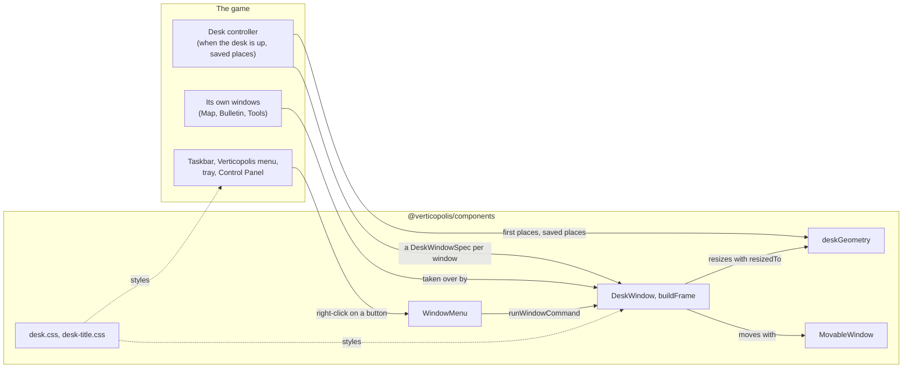
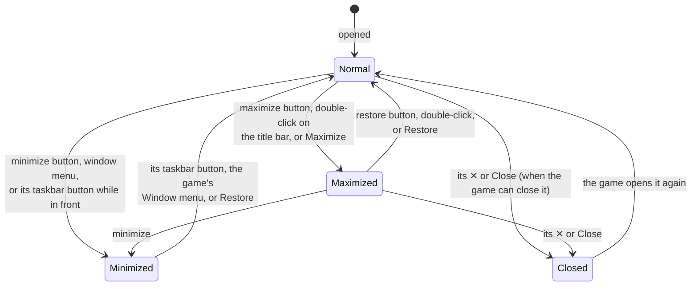
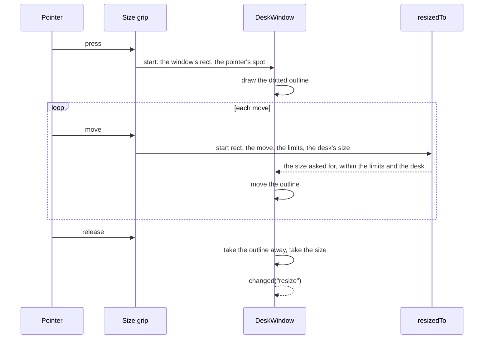

# The desk

On a computer, the game runs as a 1994 desktop: each part of the game is its
own window on a teal desk, with a taskbar along the bottom. This package holds
the desk's windows, its window menu, its geometry and its stylesheet. A game
decides when the desk comes up, which of its own elements become windows, and
what the taskbar and its menu hold. The component gallery shows
[the desk live](https://components.verticopolis.com/desktop/desk/) and
[where its windows open](https://components.verticopolis.com/desktop/layout/).

## What the package gives a game

| Import | What it is |
| --- | --- |
| `windows/desk/deskWindow` | `DeskWindow`, one window on the desk: minimize, maximize and restore, the size grip, the focus, and a move by the title bar. `buildFrame` draws a frame for content that has no window of its own. |
| `windows/desk/deskWindowMenu` | `WindowMenu`, the menu a right-click on a title bar or a taskbar button opens (Restore, Minimize, Maximize, Close), with `windowMenuState` and `runWindowCommand`. |
| `windows/desk/deskGeometry` | Pure functions over plain numbers: `defaultLayout` (where each window opens the first time), `fitRect` (a saved place kept on a smaller screen), `resizedTo` (a resize held to its limits) and `parseLayout` (a saved layout read back safely), with the size limits and the layout constants. |
| `windows/movableWindow` | `MovableWindow`, the drag by the title bar that every movable window uses, the desk's included. |
| `styles/game/desk.css` | The look: every desk window, the taskbar, the Verticopolis menu, the tray, the window menu and the Control Panel's icons. Part of `styles.css`. |
| `styles/game/desk-title.css` | The title screen on the desk: the splash as a window over the teal desk. Part of `styles.css`. |

The taskbar, its Verticopolis menu, the tray and the Control Panel are styled
here and drawn by the game, which decides what their items do.

## Putting a window on the desk

A game hands `DeskWindow` a `DeskWindowSpec` for each window:

- `el`: the window. Either a frame from `buildFrame(doc, id, title, close,
  icon)` (the game moves its content into the frame's `body`), or a window the
  game already draws with its own `.win-title` and ✕. The desk adds the title
  bar's icon, then minimize, and maximize where it is allowed, in front of the
  window's own ✕.
- `label`: the name on its taskbar button and in its buttons' labels.
- `icon`: the URL of the title bar's icon; `./favicon.png` beside the page
  when absent.
- `layer`: `app` for the tower, which stays under the small windows even when
  maximized, or `tool` for the small windows, which stack among themselves.
- `limits`: the smallest size for a window that resizes (`TOWER_LIMITS`,
  `TOOLS_LIMITS`), or null for a window of one size. `heightOnly` keeps the
  width (Tools).
- `canMax`: whether it maximizes (only the tower does in the game).
- `isOpen`, `open`, `close`: whether the game has it open, and how the game
  opens and closes it. A window without `close` never closes on the desk
  (Info and Tools, so nothing the player plays with can be lost).
- `changed`: heard after a move, a resize, a minimize, a restore, a maximize
  and an un-maximize, for the taskbar, the saved layout and the analytics.
- `pressed`: heard on any press in the window, so the game can bring it to
  the front.

`DeskWindow` adds three classes the stylesheet reads: `desk-minimized`,
`desk-maximized` and `desk-active` (the window with the focus, whose title bar
is navy; every other title bar is gray). The game sets `desk` on `<body>`
while the desk is up; the window rules are keyed on it, so the same windows
keep the game's ordinary layout on a phone or the title screen. `dispose`
takes everything the desk added off again.

## A window's life

- A minimized window is hidden but still laid out, so the tower's canvas keeps
  its size while it waits on the taskbar.
- A maximized window fills the desk and remembers the place it had, which a
  restore puts back. It has no size grip and does not move.
- Windows stack in the order they were pressed, and only the last one pressed
  has a lit title bar.

## Resizing

A window with `limits` gets a size grip at its bottom right corner. Nothing
resizes while the pointer moves: a dotted outline shows the size, and the
window takes it once, on release, so the tower's canvas resizes once per
resize.

## The window menu

A right-click on a window's title bar or taskbar button, or Shift+F10 or the
context menu key on a focused taskbar button, opens `WindowMenu` for that
window: Restore, Minimize, Maximize and Close. `windowMenuState` grays each
one that does not apply: Restore while the window is in front at its own
size, Minimize while it is minimized, Maximize for a window that cannot
maximize or already has, Close for a window the game never closes. Up and
Down move through the items; Escape or a press outside closes the menu.
`runWindowCommand` runs the pick, bringing the window to the front first for
Restore and Maximize, as 1995 did.

## Where windows open

`defaultLayout(deskW, deskH)` places every window the first time the desk
comes up:

| Window | Where it opens |
| --- | --- |
| Tools | Top left, `TOOLS_WIDTH` (184 px) wide, as tall as the desk up to 600 px |
| Info | A strip across the top, between Tools and the right-hand column |
| Tower | Under Info, between Tools and the column, down to the foot of the desk; at least 320 by 240 |
| Map | The top of the right-hand column, `SIDE_COLUMN` (300 px) wide |
| Bulletin | The foot of the column; on a desk too short for it under the Map, over the tower's sky at the left |
| Tower Info | Under Info, left of the column |
| Control Panel | The middle of the desk |

Windows of one size take their own size, so only their corner counts. A
saved place goes through `fitRect` when the desk opens: a window bigger than
the desk shrinks to fit (never below its limits), and its title bar stays on
the screen so it can always be dragged back. `parseLayout` reads a saved
layout and drops anything that is not a usable rectangle, so a damaged store
opens that window's default place.

## The taskbar and the stylesheet

`desk.css` styles the pieces a game draws around the windows. Their class
names are the contract:

| Class | What it is |
| --- | --- |
| `.desk-area` | The desk the windows sit on, above the taskbar |
| `.desk-taskbar` | The 28 px bar along the bottom |
| `.desk-start`, `.desk-start-menu`, `.desk-start-stripe`, `.desk-start-list` | The Verticopolis button and the menu it opens upward, with its stripe down the side and its `.mb-item` rows |
| `.desk-tasks`, `.desk-task` (`.on` while in front) | One button per open window |
| `.desk-tray`, `.desk-tray-display`, `.desk-tray-sound` (`.muted`), `.desk-tray-clock` | The tray: the Control Panel's monitor, the speaker and the clock |
| `.desk-win-menu` | The window menu (`WindowMenu` draws it) |
| `.desk-control-icons`, `.desk-control-icon`, `.desk-control-status` | The Control Panel's icons and its status line |
| `.desk-outline`, `.desk-grip` | The resize outline and the size grip (`DeskWindow` draws them) |

The title screen on the desk (`desk-title.css`) is keyed on
`body.desk-title`: the splash sits in a window with a `.desk-title-bar` over
the teal desk, with the taskbar below it.

## Cost

Nothing on the desk runs per frame. A move writes two styles per pointer move,
a resize draws an outline and sets the size once on release, the window menu
is drawn once and re-rendered (only the grayed items change) each time it
opens, and the geometry is plain arithmetic.
