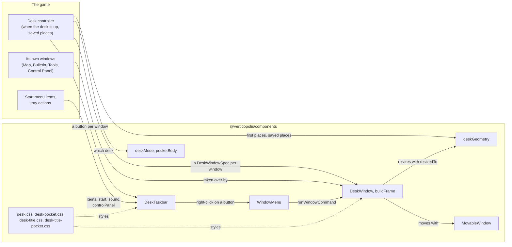
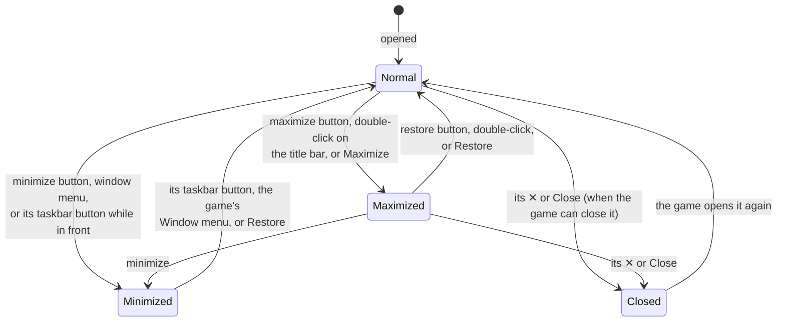
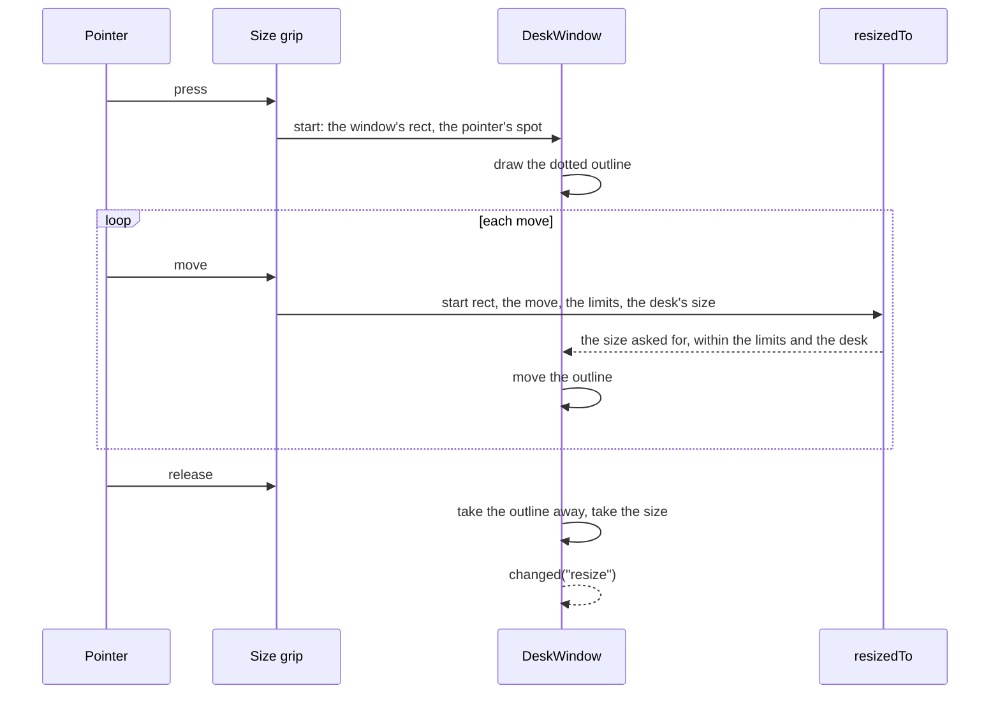

# The desk

On a computer, and on a touchscreen with room for it, the game runs as a 1994
desktop: each part of the game is its own window on a teal desk, with a
taskbar along the bottom. A smaller touchscreen gets the pocket desk, where
the tower fills the screen (see [The pocket desk](#the-pocket-desk)). This
package holds the desk's windows, its window menu, its taskbar, its geometry
and its stylesheets. A game decides when the desk comes up and which desk it
gets, which of its own elements become windows, and what the taskbar's
Start menu holds and does. The component gallery shows
[the desk live](https://components.verticopolis.com/desktop/desk/) and
[where its windows open](https://components.verticopolis.com/desktop/layout/).

## What the package gives a game

| Import | What it is |
| --- | --- |
| `windows/desk/deskWindow` | `DeskWindow`, one window on the desk: minimize, maximize and restore, the size grip, the focus, and a move by the title bar. `buildFrame` draws a frame for content that has no window of its own. |
| `windows/desk/deskTaskbar` | `DeskTaskbar`, the taskbar: the Start button and its menu, a button per open window, and the tray (the Control Panel's monitor, the speaker and the clock). `shownItems` and `trayClock` are the pure parts it draws from. |
| `windows/desk/deskPocket` | `deskMode` (which desk a screen gets), `pocketBody` (the grid inside the pocket tower window), the body classes `DESK_TOUCH_CLASS` and `DESK_POCKET_CLASS`, `POCKET_BODY_CLASS`, and the media queries `TOUCH_MQ` and `TOUCH_DESK_MQ`. |
| `windows/desk/deskControlPanel` | `ControlPanel`, the Control Panel's window: the large icons the game picks from the four the package draws (`ControlIcon`), their names and tooltips, an object count, and a ✕. Each press goes to the game; `setLabel` renames an icon, such as "Sounds: Off". |
| `windows/desk/deskWindowMenu` | `WindowMenu`, the menu a right-click on a title bar or a taskbar button opens (Restore, Minimize, Maximize, Close), with `windowMenuState` and `runWindowCommand`. |
| `windows/desk/deskHelp` | `buildHelpWindow`, the Help window: the Player's Manual in a page frame under its own menu bar (a `MenuBarModel` the game gives, with `menus.render` for fresh check marks; Alt stays with the game's bar; `dispose` takes its page listeners off) and Contents, Back, Forward and Open in Browser, with `setNav` turning Back and Forward on and off. The game decides what the menus and buttons do and which page the frame shows. |
| `windows/desk/deskGeometry` | Pure functions over plain numbers: `defaultLayout` (where each window opens the first time), `fitRect` (a saved place kept on a smaller screen), `resizedTo` (a resize held to its limits) and `parseLayout` (a saved layout read back safely), with `DESK_WINDOW_IDS`, the size limits and the layout constants. |
| `windows/movableWindow` | `MovableWindow`, the drag by the title bar that every movable window uses, the desk's included. |
| `styles/game/desk.css` | The look: every desk window, the taskbar, the Start menu, the tray, the window menu and the Control Panel's icons. Part of `styles.css`. |
| `styles/game/desk-pocket.css` | The desk on a touchscreen: the touch chrome and the pocket desk. Part of `styles.css`. |
| `windows/desk/deskTitle` | `DeskTitle`, the title screen on the desk: the window's title bar and the taskbar around the page's splash, on a computer or (`show(true)`) the pocket desk. Given `controlPanel`, it also holds the Control Panel, opened by `openControl()` or the tray's monitor over the title window, so the Start menu can read the same over the title screen as over a tower. |
| `styles/game/desk-title.css` | The title screen on the desk: the splash as a window over the teal desk, and where its Control Panel opens. Its buttons are the scheme's plain push buttons, except the main one (Continue, or New Tower with no tower to continue), which keeps the default ring and bold text and wears the scheme's accent: amber in Classic, violet in Skyline (`schemes/skyline.css`), yellow in High Contrast (`schemes/high-contrast.css`). Part of `styles.css`. |
| `styles/game/desk-title-pocket.css` | The title screen on the pocket desk: the same window fitted to a phone, upright and sideways. Part of `styles.css`. |

The taskbar, its Start menu and the tray are drawn here
(`DeskTaskbar`); the game names the menu's items and decides what each press
does. The Control Panel's window is drawn here too (`ControlPanel`); the game
names its icons and decides what each one opens.

## Putting a window on the desk

A game hands `DeskWindow` a `DeskWindowSpec` for each window:

- `id`: the window's name, which the window menu and the saved layout use.
- `el`: the window. Either a frame from `buildFrame(doc, id, title, close,
  icon)` (the game moves its content into the frame's `body`), or a window the
  game already draws with its own `.win-title` and ✕. The desk adds the title
  bar's icon, then minimize, and maximize where it is allowed, in front of the
  window's own ✕.
- `label`: the name on its taskbar button and in its buttons' labels.
- `icon`: the URL of the title bar's icon, for a window that draws its own
  title bar; `./favicon.png` beside the page when absent. A `buildFrame`
  frame already has its icon (the `icon` it was given), and `DeskWindow`
  leaves it alone.
- `layer`: `app` for the tower, which stays under the small windows even when
  maximized, or `tool` for the small windows, which stack among themselves.
- `limits`: the smallest size for a window that resizes (`TOWER_LIMITS`,
  `TOOLS_LIMITS`, `HELP_LIMITS`), or null for a window of one size.
  `heightOnly` keeps the width (Tools).
- `canMax`: whether it maximizes (the tower and Help do in the game).
- `isOpen`, `open`, `close`: whether the game has it open, and how the game
  opens and closes it. A window without `close` never closes on the desk
  (Info and Tools, so nothing the player plays with can be lost).
- `changed`: heard after a move, a resize, a minimize, a restore, a maximize
  and an un-maximize, for the taskbar, the saved layout and the analytics.
- `pressed`: heard on any press in the window, so the game can bring it to
  the front.

`DeskWindow` adds three classes the stylesheet reads: `desk-minimized`,
`desk-maximized` and `desk-active` (the window with the focus, whose title bar
is navy; every other title bar is gray). The game sets `desk` on `<body>`
while the desk is up; the window rules are keyed on it, so the same windows
keep the game's ordinary layout on a phone or the title screen. `dispose`
takes everything the desk added off again.

## A window's life

- A minimized window is hidden but still laid out, so the tower's canvas keeps
  its size while it waits on the taskbar.
- A maximized window fills the desk and remembers the place it had, which a
  restore puts back. It has no size grip and does not move.
- Windows stack in the order they were pressed, and only the last one pressed
  has a lit title bar.

## Resizing

A window with `limits` gets a size grip at its bottom right corner. Nothing
resizes while the pointer moves: a dotted outline shows the size, and the
window takes it once, on release, so the tower's canvas resizes once per
resize.

## The window menu

A right-click on a window's title bar or taskbar button, or Shift+F10 or the
context menu key on a focused taskbar button, opens `WindowMenu` for that
window: Restore, Minimize, Maximize and Close. `windowMenuState` grays each
one that does not apply: Restore while the window is in front at its own
size, Minimize while it is minimized, Maximize for a window that cannot
maximize or already has, Close for a window the game never closes. Up and
Down move through the items; Escape or a press outside closes the menu.
`runWindowCommand` runs the pick, bringing the window to the front first for
Restore and Maximize, as 1995 did.

## The taskbar

`new DeskTaskbar(doc, options)` draws the taskbar; the game puts its `root`
under the desk, calls `start()` once it is on the page and `stop()` when the
desk goes away. `render(entries)` shows one button per open window, each a
`TaskEntry` (`id`, `label`, `active`, `minimized`); the window in front and
not minimized is pressed in. `setSound(on)` shows the sound's state on the
speaker.

| Option | What it does |
| --- | --- |
| `items` | The Start menu, in order: each a `StartItem` (`id`, `label`), a null for a separator |
| `shown` | Whether an item shows, asked each time the menu opens; a separator with nothing after it goes too |
| `start` | Heard with an item's `id` when it is picked |
| `task` | Heard with a window's `id` when its button is pressed |
| `controlPanel` | Opens the Control Panel from the tray's monitor; without it the tray has no monitor |
| `sound` | Turns the sound on or off from the tray's speaker; without it the tray has no speaker |
| `windowMenu` | The `WindowMenu` handlers (`state`, `run`); without them a right-click on a button does nothing. `openWindowMenu(id, x, y)` opens it from a title bar |
| `icon`, `className`, `now` | The button icon (`DESK_ICON` when absent), a class beside `desk-taskbar`, and the clock's time (the computer's when absent) |
| `opened`, `tray` | Heard when the menu opens and when a tray button is pressed, for the analytics |

The menu opens upward with its first item focused. Up and Down move through
it, Escape closes it and puts the focus back on its button, and a press
anywhere else closes it. The clock reads like the 1995 tray (`4:34 PM`) and
wakes once a minute.

## Where windows open

`defaultLayout(deskW, deskH)` places every window the first time the desk
comes up:

| Window | Where it opens |
| --- | --- |
| Tools | Top left, `TOOLS_WIDTH` (184 px) wide, as tall as the desk up to 600 px |
| Info | A strip across the top, between Tools and the right-hand column |
| Tower | Under Info, between Tools and the column, down to the foot of the desk; at least 320 by 240 |
| Map | The top of the right-hand column, `SIDE_COLUMN` (300 px) wide |
| Bulletin | The foot of the column; on a desk too short for it under the Map, over the tower's sky at the left |
| Tower Info | Under Info, left of the column |
| Control Panel | The middle of the desk |

Windows of one size take their own size, so only their corner counts. A
saved place goes through `fitRect` when the desk opens: a window bigger than
the desk shrinks to fit (never below its limits), and its title bar stays on
the screen so it can always be dragged back. `parseLayout` reads a saved
layout and drops anything that is not a usable rectangle, so a damaged store
opens that window's default place.

## The pocket desk

`deskMode(screen)` decides which desk a screen gets. The game reads the
screen (`TOUCH_MQ`, `TOUCH_DESK_MQ` and its own computer and width checks)
and sets the body class that goes with the answer:

| The screen | `deskMode` | Body classes |
| --- | --- | --- |
| A computer with room for the desk | `desk` | `desk` |
| A touchscreen at least 1024 by 600 (a sideways tablet, a 12.9 inch iPad held upright) | `desk` | `desk`, `desk-touch` |
| A smaller touchscreen (a phone held either way, a smaller upright tablet) | `pocket` | `desk`, `desk-touch`, `desk-pocket` |
| Anything else | null | none: the game's own layout |

A tester's switch overrides the screen: `off` gives no desk, `pocket` the
pocket desk anywhere, and `any` the full desk on any screen at least
tablet-wide.

On a touchscreen (`body.desk-touch`) the taskbar and the menu rows are 44 px
tall, each title-bar button has a 44 px touch area, and the Start menu opens
just above the taller taskbar. When a page opts into a phone's
cutout area (`viewport-fit=cover` in its viewport meta), the desk area keeps
in from the safe-area insets on every side and the taskbar pads its sides and
foot, so no window or tool sits under a notch. On the pocket desk
(`body.desk-pocket`) the tower window fills the desk and never moves; it has
no Minimize or Maximize button. The game builds `pocketBody(doc)` inside it
and moves Info, Tools and the tower's stage into that grid; the stylesheet
stacks them on an upright phone and puts Tools at the left on a sideways
phone or an upright tablet. On an upright phone the pinned Inspect and
Bulldoze show their icons alone, and Info's traffic chip shows its meter and
word without the "Traffic" label, so the five rating stars and "Backed up" fit
a 360 px phone. The Map floats over the tower at its phone size; on a sideways
phone, where the tower's view is short, it may take that view's whole height,
and the map keeps its shape in the middle of the card. The Bulletin, Tower
Info and the Control Panel open across the top of the desk at the height of
what they hold, with the tower showing below; the Bulletin stops at a third of
the desk and its log scrolls. A drag by the title bar slides any of them, or
the Map, to another spot inside the desk. The taskbar switches between them. On an upright
phone the seven Tools tabs share the strip's width, and the tools row scrolls
sideways with no fade, so its last tool shows whole. The Start button shows
its icon alone and each window's button its word alone. The gallery's Pocket
desk page shows a sample one live, in a phone-shaped frame.

## The class contract

`desk.css` and `desk-pocket.css` style the desk's pieces. Their class names
are the contract:

| Class | What it is |
| --- | --- |
| `.desk-area` | The desk the windows sit on, above the taskbar |
| `.desk-taskbar` | The 28 px bar along the bottom (`DeskTaskbar` draws it and everything in it) |
| `.desk-start`, `.desk-start-menu`, `.desk-start-stripe`, `.desk-start-list` | The Start button and the menu it opens upward, with its stripe down the side and its `.mb-item` rows |
| `.desk-tasks`, `.desk-task` (`.on` while in front) | One button per open window |
| `.desk-tray`, `.desk-tray-display`, `.desk-tray-sound` (`.muted`), `.desk-tray-clock` | The tray: the Control Panel's monitor, the speaker and the clock |
| `.desk-win-menu` | The window menu (`WindowMenu` draws it) |
| `.desk-control-icons`, `.desk-control-icon`, `.desk-control-status` | The Control Panel's icons and its status line |
| `.desk-outline`, `.desk-grip` | The resize outline and the size grip (`DeskWindow` draws them) |
| `body.desk-touch`, `body.desk-pocket` | The touch chrome and the pocket desk (`DESK_TOUCH_CLASS`, `DESK_POCKET_CLASS`) |
| `.desk-pocket-body` | The grid inside the pocket tower window (`pocketBody` draws it) |

The title screen on the desk (`desk-title.css`) is keyed on
`body.desk-title`: the splash sits in a window with a `.desk-title-bar` over
the teal desk, with the taskbar below it. `DeskTitle.show(true)` puts it on
the pocket desk instead and adds `body.desk-title-pocket`
(`DESK_TITLE_POCKET_CLASS`, `desk-title-pocket.css`): the window keeps its
menu bar and fills the screen above the 44 px taskbar, under the browser's own
bars. On an upright phone the poster fills its top and the buttons stack in
the gray bar below (two by two on a short screen); held sideways, the buttons
stand in a gray panel beside the poster. The poster takes the height the
buttons leave and the premise line is hidden. On a screen too short even for
that the window scrolls, so every button and the credit line can be reached.
The toast rail (`#toast-wrap`) moves to the foot of the poster, so a notice
shown with the title screen up covers neither the logo nor the buttons; the
menu bar and the taskbar, with the menus they open, draw over it.
A second `show` switches between the
two, as turning a tablet can.

## Cost

Nothing on the desk runs per frame. A move writes two styles per pointer move,
a resize draws an outline and sets the size once on release, the window menu
is drawn once and re-rendered (only the grayed items change) each time it
opens, the taskbar re-renders when a window opens, closes, minimizes or takes
the focus and once a minute for its clock, and the geometry is plain
arithmetic.
